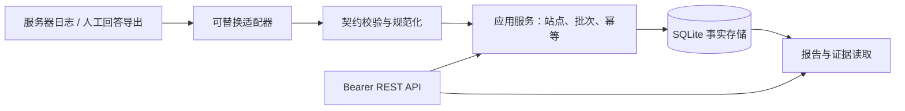

# 架构决策 ADR-001：先建立证据闭环

状态：已实现本地 MVP 及 P01/P02 本地接入能力；日期：2026-10-29。目标是验证中国大陆 AI 产品的抓取与回答曝光证据，不输出无法解释的 GEO 综合分。最新验证和采集契约见 [INGESTION.md](INGESTION.md)。

## 模块边界

| 模块 | 代码 | 负责 | 不负责 |
| --- | --- | --- | --- |
| 入口 | geo/api.py | 身份、体积限制、HTTP 错误映射 | 平台 SDK、报告口径 |
| 站点/采集用例 | geo/service.py | 站点范围、批次事务、幂等、品牌匹配、报告 | 上游 API 调用 |
| 标准契约 | geo/contracts.py | URL、时间、类型与长度校验 | 数据库 |
| 适配器 | geo/adapters.py | 外部字段映射到稳定事件、UA 声明分类 | SQL、直接写报告 |
| 存储 | geo/db.py | 连接事务、外键、schema version 5与增量迁移 | 采集逻辑 |
| 运维 | geo/paging.py、geo/retention.py、geo/backup.py | 签名分页、预览删除、逻辑保留边界、新文件恢复 | TLS、物理擦除、生产灾备 |
| 模拟采样 | geo/jobs.py | 持久状态、租约、重试和原子完成 | 真实provider、常驻调度 |
| 品牌与复核 | geo/brands.py | 配置版本、稳定品牌ID、别名歧义、审计投影 | 情感、模型推断、真实审核人身份 |
| 报告导出 | geo/reporting.py | 统一筛选、CSV编码与单元格处理 | 数据存储、后台任务 |
| 目录与覆盖 | geo/catalog.py、geo/coverage.py | 来源分级、声明分类、清单页面集合对比 | 实际IP/DNS核验、收录或曝光推断 |
| 站点安全 | geo/security.py、geo/ownership.py | HTTPS挑战、站点日志密钥、有效期和撤销 | 多租户、爬虫身份核验 |
| 文件采集 | geo/collector.py | JSONL读取、outbox、位点、重命名轮转 | 平台回答采集、后台调度 |
| 演示与回归 | scripts/demo.py、tests/ | HTTP 演示、数据与权限测试 | 真实平台表现背书 |

选择 Python 标准库减少首轮安装与网络依赖；SQLite 适合单机低流量验证。以后在 Service 用例边界引入仓储接口迁移 PostgreSQL，不让各采集器直接写数据库。当前报告与采集用例在同一模块，规模扩大后拆 report service；暂不引入微服务、Redis 和异步队列。

## 数据与口径

sites 保存站点 origin、品牌及竞品名称/别名；events 保存 site_id、kind、source、event_id、UTC observed_at、版本化规范 JSON。主键 `(site_id, kind, source, event_id)`，按站点与时间建索引。事件不可覆盖：完全相同重试不增量，不同内容冲突整批回滚。source 是由运营者指定的采集源标识，换 source 会形成另一份证据，需避免重复导入。

- 日志仅说明请求到达；失败为声明 AI 日志 HTTP >=400。当前仅小型 UA 目录，全部 unverified，不信任客户端上报的 verified 字段。未知 UA 保留未知，国内 bot 目录待官方证据补齐。
- 回答样本保留 platform/model/surface/locale/prompt/answer/citations/evidence_url。人工输入不自动核验真假，缺证据链接仍可保存，属于待复核样本。
- 提及样本为回答字面包含任一配置品牌；逐品牌计数包含竞品，不区分好评/负评。别名可能重叠，计数不可相加当作独立回答数。
- 本站引用样本为 citations 中至少一个 URL 的完整 netloc 与本站一致（不默认包含子域）。引用率分母是上传的所有回答样本；混合平台/入口时仅作总样本摘要，不能推断市场份额。
- 页面观察数来自声明 AI 请求的去重规范 URL，包含失败请求；没有内容目录，不能声称全站覆盖率。空样本比率返回 null。
- 时间统一 UTC，查询为 `[start,end)`；北京时间自然日由调用端转换。URL 丢弃查询与片段；不存 IP、Cookie、完整请求头。正文需要导入前脱敏。

## 可替换采集层

现有 `Adapter.normalize(record)->dict`、LOG_ADAPTERS、ANSWER_ADAPTERS 是显式注册表。json-v1 和 nginx-json-v1 输出一致日志模型，manual-v1 输出回答模型。新平台必须经 Service 校验、事务与去重后落库，禁止绕过服务写事实表。

有副作用的 Collector 已独立于纯 Adapter：文件采集器负责读取、批次、outbox、检查点和单次HTTP发送；Adapter 管格式。仅持久提交确认后推进 cursor，失败保留原始批次等待下一次执行。后续队列负责 queued/running/succeeded/failed、限额与退避；尚未实现后台轮询、CDN 拉取或任何付费 API 调用。

大陆产品接入优先采用运营者合法取得的人工导出/官方服务，候选包括豆包、DeepSeek、Kimi、通义、文心、腾讯元宝；每一项在接入前确认官方接口能力和使用条件。模型 API、联网搜索 API 与消费产品 UI 必须分开标记。无法获得来源列表时 citations 留空，不能把回答中随意出现的网址自动包装为已验证引用。

## 开源参考到模块的映射

以下为 2026-10-29 对官方仓库 README、架构文档、目录与许可证的核查；不是完整源码或供应链审计。当前 xing 实现为独立编写，没有复制两个项目源码、素材、数据库或迁移。

| 上游入口 | 可借鉴内容 | xing 落地 / 后续 | 不直接复用的原因 |
| --- | --- | --- | --- |
| GEOInflow `src/lib/liekan/crawlers` | 身份声明、核验、目的分别保存 | 现有声明与 verification；后补证据目录 | 国内平台名单不能靠猜测；IP/DNS核验需独立实现 |
| GEOInflow `src/lib/liekan/log-ingestion`、`src/liekan-agent` | 批次、来源、断点、重传 | 已有稳定事件ID与事务；后补 checkpoint | 其采集协议、持久队列与 Umami/PG schema 耦合 |
| GEOInflow `contracts`、内容目录与报告 | 统一时间范围、未知值、内容覆盖分母 | UTC区间、null覆盖率；后补 inventory | 没有清单/连续日志不能照搬覆盖数值或权重 |
| GEOInflow tracker / upstream | AI 引流与抓取分开、权限适配 | 架构保留独立证据类型 | 当前没有访客会话/转化，不能复用其归因结论；不搬整套 Umami |
| Getcito `packages/api-spec/src/openapi.json` | 品牌、竞品、提示词、报告资源划分 | 站点/回答/报告 REST；后拆品牌与提示词实体 | 现阶段不用其 TypeScript API 类型与数据迁移 |
| Getcito `packages/lib/src/db` | 回答快照、品牌与竞品关联、引用 | 当前规范化 answer 事件；后补 prompt版本与采样任务 | 历史 schema 与 Drizzle/PostgreSQL 绑定 |
| Getcito `apps/worker` 与采集 provider 配置 | 后台任务、配额、适配器选择 | 计划持久任务与 provider contract | pg-boss/DBOS、供应商凭证及付费额度不能继承 |
| Getcito web、white-label、Auth0 | 多环境配置与鉴权隔离 | 当前本地实例 token；后补组织权限 | 不搬品牌资产、遥测、白标服务集成及生产密钥 |

具体许可义务、上游溯源和复用前检查见 [THIRD_PARTY_REVIEW.md](THIRD_PARTY_REVIEW.md)。

## 演进与生产门槛

第四轮新增brand_configs与mention_reviews表，使用不可变配置和追加审计记录；原始回答不变，查询按选定配置重算提及。三种读取形式（报告、明细、CSV）复用同一筛选与投影；详见 [BRANDS_AND_REPORTS.md](BRANDS_AND_REPORTS.md)。

增量：已新增 inventories 不可变快照表（site_id、id、created_at、source、urls），report可固定inventory_id；最新的目录和统计口径以 [COVERAGE_AND_CRAWLERS.md](COVERAGE_AND_CRAWLERS.md) 为准。无清单时仍保留unknown语义，有清单时分别计算观察覆盖与2xx成功覆盖。

阶段1先接一个授权站点，证明真实日志可以稳定流入，人工回答证据可复核。后续再做页面清单、中文品牌消歧、平台分层报告和 worker。公网部署前须完成域名所有权验证、组织/站点授权、站点采集密钥、TLS 网关与限流、分页和保留/删除策略、备份恢复演练。当前全量事件读取不适合大数据集，stdlib HTTP server 不作为公网生产服务器。
# 本地容量与状态增量（2026-10-29）

`geo/limits.py` 管理单请求条数/UTF-8字节预算；`geo/reporting.py` 统一筛选规范化和SQL谓词；Service的报告/CSV读取与分页复用谓词。品牌投影通过临时选择表与最新复核序号缩小读取范围。`geo/status.py` 使用只读数据库连接输出无正文/密钥/路径的管理员摘要，API负责鉴权和503映射。GET序列化在发送成功响应前检查预算；超限422，不截断统计。schema仍为v5，不引入外部依赖。详细契约与剩余范围见 CAPACITY_AND_STATUS.md。
# 审计与保留增量（2026-10-29）

共享游标签名迁入geo/cursors.py；geo/paging.py增加审计历史分页，固定配置/复核上限并与事件游标隔离。geo/retention.py在同一事务内限制事件键、任务ID、复核序号的合计条数/字节，且在写计划或删数据前预检完整返回计划。geo/db.py区分初始化创建与运行中仅打开既有库，固定绝对路径。未升级schema。并发基线与兼容性变更见 AUDIT_AND_RETENTION.md。
# 站点索引与数据库预算增量（2026-10-29）

schema v6增加site_positions，旧站点按rowid回填，注册与序号写入同事务；site_page复用签名游标且绑定独立资源范围。清单读取在一致读事务先查存储字节再读正文，导入先校验存储/响应预算。Database普通连接新增忙锁等待与progress handler截止，异常先禁用截止回调再整笔回滚。API仅依据SQLite错误码公开busy/timeout契约；其余错误不泄漏细节。备份/状态同步识别v6，demo更新为逐页查站。详见 SITES_AND_DATABASE.md。
# 离线人工样本增量（2026-10-30）

geo/samples.py只依赖JSON解析、contracts与ManualAnswerAdapter，不依赖Database/Service/HTTP；按物理行流式读取并设置文件/行/条数限制。模板明确source与record，严格要求入口等字段，拒绝未知字段和重复JSON键。诊断只输出行号与固定代码，不输出归一化正文。平台矩阵仅说明本项目记录契约，实际供应商能力保持未验证。schema仍v6，详情见 MANUAL_SAMPLES.md。
